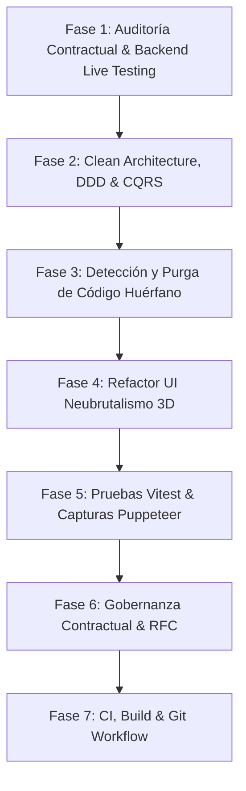

# 📘 Playbook Maestro Agnóstico: Auditoría y Refactorización Integral de Casos de Uso (Frontend Portal)

> **Ubicación:** `.agents/prompts/use_case_audit_and_refactor_playbook.md`  
> **Ámbito:** Frontend Web Portal (`apps/chatbot/web/portal`)  
> **Objetivo:** Guía y plantilla de ejecución estandarizada para auditar, modernizar, desacoplar y certificar cualquier Caso de Uso (`CU-01` a `CU-10`) en sincronía con el backend FastAPI, Clean Architecture, Neubrutalismo 3D y Tolerant Reader.

---

## 🏷️ Variables de Contexto del Caso de Uso

Al instanciar o ejecutar este playbook para un caso de uso específico, sustituir los siguientes parámetros:

| Variable | Descripción | Ejemplo (CU-03) |
| :--- | :--- | :--- |
| `${CU_ID}` | Identificador oficial del caso de uso | `CU-03` |
| `${CU_NUM}` | Número de dos dígitos | `03` |
| `${CU_NAME}` | Nombre funcional completo | `Consola Conversacional con Idempotencia Resiliente` |
| `${CU_SLUG}` | Slug normalizado para ramas y archivos | `chat-idempotency` |
| `${PRIMARY_ROUTE}` | Ruta frontend en el portal Next.js | `/chat` o `/dashboard` |
| `${BACKEND_ENDPOINT}` | Endpoint principal de la API backend | `/conversations` o `/chat/messages` |
| `${BACKEND_STEP}` | Paso asociado en el walkthrough de backend | `Step 3` |
| `${RFC_ID}` | Identificador del RFC de gobernanza | `RFC-33` |
| `${BRANCH_NAME}` | Nombre de la rama git de trabajo | `feat/03-chat-idempotency` |

---

## 🎯 Declaración de Rol y Misión

Actúas como **Arquitecto Frontend Senior y Especialista en Clean Architecture, UX Neubrutalista y Sistemas Distribuidos Multi-Tenant**. Tu misión es llevar el caso de uso `${CU_ID}` desde su estado actual hasta una implementación de grado de producción, resiliente ante discrepancias de backend, desacoplada en capas DDD/CQRS, visualmente impactante bajo el sistema Neubrutalism 3D, validada con pruebas unitarias/integración al 100% y documentada formalmente con su RFC y capturas en vivo.

---

## 📋 Metodología de Ejecución en 7 Fases



---

### Fase 1: Auditoría Contractual & Backend Live Testing

1. **Inspección de API en Vivo:**
   - Verificar disponibilidad del backend en `http://localhost:8000/docs` o `http://localhost:8000/openapi.json`.
   - Ejecutar llamadas de sondeo HTTP reales (mediante `curl` o script temporal en node) hacia `${BACKEND_ENDPOINT}`.
   - Contrastar los esquemas reales del backend con los tipos TypeScript existentes en el portal.
2. **Aplicación del Patrón Tolerant Reader:**
   - Identificar campos obligatorios, opcionales, alias y discrepancias de nombres (por ejemplo `id` vs `tenant_id`, snake_case vs camelCase).
   - Construir mappers defensivos (`toDomain`, `toDTO`) que garanticen que el cliente frontend no colapse si el backend omite campos opcionales o agrega nuevas propiedades.
3. **Identificación de Brechas de Contrato:**
   - Si el backend carece de endpoints o capacidades necesarias para el caso de uso, formular la propuesta de cambio para el backend antes de continuar.

- [ ] **Checklist Fase 1:**
  - [ ] Endpoint backend verificado en vivo (`${BACKEND_ENDPOINT}`).
  - [ ] Esquema Swagger / OpenAPI documentado e inspeccionado.
  - [ ] Discrepancias tipadas y mitigadas con Tolerant Reader.

---

### Fase 2: Clean Architecture, DDD & Segregación CQRS

Reestructurar o refactorizar el código de `${CU_ID}` en capas estrictamente independientes:

1. **Capa de Dominio (`src/domain/${CU_SLUG}/`):**
   - Entidades puras y Value Objects inmutables con validación en creación.
   - Tipos de modelos de negocio sin dependencias de React, Next.js, Axios o UI.
   - Definición de interfaces de puertos (`I${CU_NAME}Repository`, `I${CU_NAME}Service`).
2. **Capa de Aplicación (`src/application/${CU_SLUG}/`):**
   - Segregación CQRS: separar claramente **Commands** (mutaciones de estado, envíos con `Idempotency-Key`) de **Queries** (lecturas, filtrado, polling o streams).
   - Casos de uso ejecutables (`Execute...UseCase.ts`) orquestados con hooks reactivos (`use...`).
3. **Capa de Infraestructura (`src/infrastructure/api/${CU_SLUG}/`):**
   - Adaptador HTTP o SSE tipado.
   - Inyección de cabeceras obligatorias (`X-Tenant-ID`, `X-Correlation-ID`, `Idempotency-Key`).
   - Normalizadores de error (transformación de `HTTP 400/409/429/500` a excepciones de dominio).
4. **Capa de Presentación (`src/presentation/components/${CU_SLUG}/`):**
   - Separación estricta entre Container / Controller (lógica, hooks, estado) y Componentes Presentacionales puros (stateless, renderizado neubrutalista).

- [ ] **Checklist Fase 2:**
  - [ ] Entidades de dominio puras creadas sin dependencias externas.
  - [ ] Puertos e interfaces desacoplados de la implementación HTTP.
  - [ ] Commands y Queries segregados (CQRS).
  - [ ] Adaptador de infraestructura con cabeceras de trazabilidad y multi-tenant.

---

### Fase 3: Detección y Purga de Código Huérfano y Antipatrones

1. **Búsqueda de Código Huérfano (Dead / Orphan Code):**
   - Identificar archivos deprecados, hooks sin uso, tipos TypeScript duplicados o componentes no referenciados vinculados a `${CU_ID}`.
   - Ejecutar grep y análisis de imports para confirmar que ningún componente activo depende de código huérfano antes de removerlo.
2. **Erradicación de Antipatrones:**
   - ❌ **Anti-patrón 1:** Mocks hardcodeados infiltrados en rutas o servicios de producción (`useMockData = true` no controlado).
   - ❌ **Anti-patrón 2:** Fuga de contexto multi-tenant (peticiones sin `X-Tenant-ID` o con `tenant_id` quemado en código).
   - ❌ **Anti-patrón 3:** Ausencia de límites de error (`ErrorBoundary`) que provocan pantalla blanca ante fallas de red.
   - ❌ **Anti-patrón 4:** Componentes monolíticos (> 350 líneas) que combinan llamada HTTP, parsing, estado y JSX.

- [ ] **Checklist Fase 3:**
  - [ ] Código huérfano y archivos obsoletos eliminados.
  - [ ] Mocks desacoplados a entornos de prueba (`tests/mocks/` o MSW).
  - [ ] Sin fugas de contexto multi-tenant.
  - [ ] Componentes divididos en átomos y moléculas cohesivas.

---

### Fase 4: Refactor UI Neubrutalismo 3D & Experiencia de Usuario

Transformar la interfaz del caso de uso aplicando el Design System **Neubrutalism 3D**:

1. **Tokens Visuales Obligatorios:**
   - **Bordes:** `border-2` o `border-3` rígidos, `border-black dark:border-white`.
   - **Sombras 3D:** Desfase sólido sin desenfoque (`box-shadow: 4px 4px 0px #000000; dark:box-shadow: 4px 4px 0px #000000;`).
   - **Tarjetas y Paneles Elevados:** `box-shadow: 6px 6px 0px #000000;`.
2. **Micro-interacciones Físicas de Presión Mecánica:**
   - Estado default: `translate-x-0 translate-y-0 shadow-[4px_4px_0px_0px_#000]`.
   - Estado `:hover`: `hover:-translate-x-0.5 hover:-translate-y-0.5 hover:shadow-[6px_6px_0px_0px_#000]`.
   - Estado `:active` (click): `active:translate-x-1 active:translate-y-1 active:shadow-[1px_1px_0px_0px_#000]`.
3. **Paleta Cromática Funcional:**
   - Canvas: `#FAF9F6` (Light) / `#0F172A` (Dark).
   - Superficies: `#FFFFFF` / `#1E293B`.
   - Acentos: Cyber Yellow (`#FBBF24`), Action Blue (`#3B82F6`), Success Green (`#10B981`), Danger Red (`#EF4444`).
4. **Estados de Interfaz Completos:**
   - Estado Cargando (Skeleton con pulso neubrutalista).
   - Estado Vacío (Empty State con microcopy e iconografía 3D).
   - Estado de Error (Banner con bordes gruesos, código HTTP y botón de reintento).
   - Accesibilidad: Anillos de foco visibles (`focus:ring-2 focus:ring-black focus:outline-none`).

- [ ] **Checklist Fase 4:**
  - [ ] Contornos sólidos y sombras planas 3D aplicadas a todos los componentes.
  - [ ] Micro-interacciones `:hover` y `:active` táctiles funcionando fluidamente.
  - [ ] Modos Light y Dark soportados con alto contraste.
  - [ ] Estados Loading, Empty y Error implementados con estilo Neubrutalista.

---

### Fase 5: Suite de Pruebas Automatizadas & Captura Visual Puppeteer

1. **Pruebas Unitarias y de Componente (Vitest + React Testing Library):**
   - Validar entidades de dominio y transformadores Tolerant Reader.
   - Probar hooks de aplicación y casos de uso con MSW o repositorios mockeados.
   - Probar componentes de presentación verificando renderizado de estados y eventos de usuario.
   - Meta: **100% de tests passing** sin warnings ni fugas de memoria.
2. **Script de Captura Automatizada de Evidencia (Puppeteer):**
   - Crear o actualizar script `scripts/capture-cu${CU_NUM}.mjs`.
   - Configuración: Puppeteer headless, viewport desktop (1440x900) y mobile (390x844).
   - Navegación hacia `${PRIMARY_ROUTE}` en el portal en vivo (`localhost:3000`).
   - Capturar screenshots nítidos en `docs/assets/`:
     - `cu${CU_NUM}_${CU_SLUG}_default_live.png`
     - `cu${CU_NUM}_${CU_SLUG}_interactive_state_live.png`
     - `cu${CU_NUM}_${CU_SLUG}_action_result_live.png`

- [ ] **Checklist Fase 5:**
  - [ ] Pruebas Vitest ejecutadas y 100% exitosas (`npm test` o `make test`).
  - [ ] Script de Puppeteer `scripts/capture-cu${CU_NUM}.mjs` ejecutado exitosamente.
  - [ ] Evidencia visual almacenada en `docs/assets/`.

---

### Fase 6: Gobernanza Contractual & Redacción RFC

Redactar o actualizar formalmente la especificación de gobernanza en `docs/rfcs/${RFC_ID}-backend-${CU_SLUG}-contract.md`:

1. **Estructura Requerida del RFC:**
   - **Metadatos:** Número RFC, Título, Fecha, Autores, Estado (`ACEPTADO E IMPLEMENTADO`), Caso de Uso vinculado, ADR vinculado.
   - **Resumen Ejecutivo & Declaración de Conformidad.**
   - **Especificación del Contrato OpenAPI:** Endpoints, métodos, payloads de petición, cabeceras requeridas, esquemas de respuesta JSON y códigos de estado HTTP.
   - **Análisis de Resiliencia y Tolerant Reader:** Tabla comparativa entre campos del backend y el modelo de dominio en frontend.
   - **Manejo de Errores y Contingencias:** Mapeo de `HTTP 400`, `401`, `403`, `404`, `409`, `422`, `429`, `500`.
   - **Evidencia Visual y Verificación:** Enlaces a las capturas Puppeteer de `docs/assets/`.

- [ ] **Checklist Fase 6:**
  - [ ] Documento RFC creado en `docs/rfcs/${RFC_ID}-backend-${CU_SLUG}-contract.md`.
  - [ ] Especificación de endpoints y contratos JSON exhaustiva.
  - [ ] Mapeo Tolerant Reader documentado.
  - [ ] Capturas visuales incrustadas.

---

### Fase 7: Validación de Calidad & Disciplina de Entrega Git

1. **Validación de Compilación y Calidad:**
   - Ejecutar `make test` (o `npm test`) -> Debe pasar al 100%.
   - Ejecutar `make stack/build` (o `npm run build`) -> Cero errores TypeScript / ESLint.
   - Ejecutar `git status` -> Asegurar que no existan archivos residuales, logs ni temporales.
2. **Flujo de Ramas y Git Delivery (según `.agents/rules/git-workflow.md`):**
   - Trabajar en rama aislada `feat/${CU_NUM}-${CU_SLUG}` creada a partir de `development`.
   - Realizar commits incrementales claros siguiendo la convención Conventional Commits:
     - `feat(${CU_SLUG}): ...`
     - `test(${CU_SLUG}): ...`
     - `docs(${CU_SLUG}): ...`
   - Abrir Pull Request hacia `development`:
     - Título: `feat(${CU_SLUG}): implementacion integral de ${CU_ID} con arquitectura limpia y neubrutalismo 3d`
     - Descripción con tabla de verificación, métricas de tests y capturas de evidencia.
   - Ejecutar **Squash and Merge** hacia `development` generando un único commit atómico:
     `feat(${CU_SLUG}): implementacion integral de ${CU_ID} (#<PR>)`
   - Mantener sincronización con `development`.

- [ ] **Checklist Fase 7:**
  - [ ] Build de producción limpio y sin errores de tipado.
  - [ ] Suite completa de tests en verde.
  - [ ] Pull Request abierto y mergeado vía Squash hacia `development`.
  - [ ] Estado de ramas limpio y sincronizado.

---

## 🚀 Plantilla de Prompt de Invocación Rápida

Para iniciar una nueva auditoría y refactorización, invocar el comando `/plan` adjuntando el siguiente bloque contextual:

```markdown
/plan
Por favor, ejecuta la auditoría y refactorización integral del Caso de Uso:
- Caso de Uso: ${CU_ID} - ${CU_NAME}
- Slug: ${CU_SLUG}
- Endpoint Backend: ${BACKEND_ENDPOINT}
- Ruta Portal: ${PRIMARY_ROUTE}
- RFC Objetivo: ${RFC_ID}

Sigue estrictamente el playbook maestro en `.agents/prompts/use_case_audit_and_refactor_playbook.md` y los estándares de `.agents/rules/use-case-audit-standards.md`.
```
