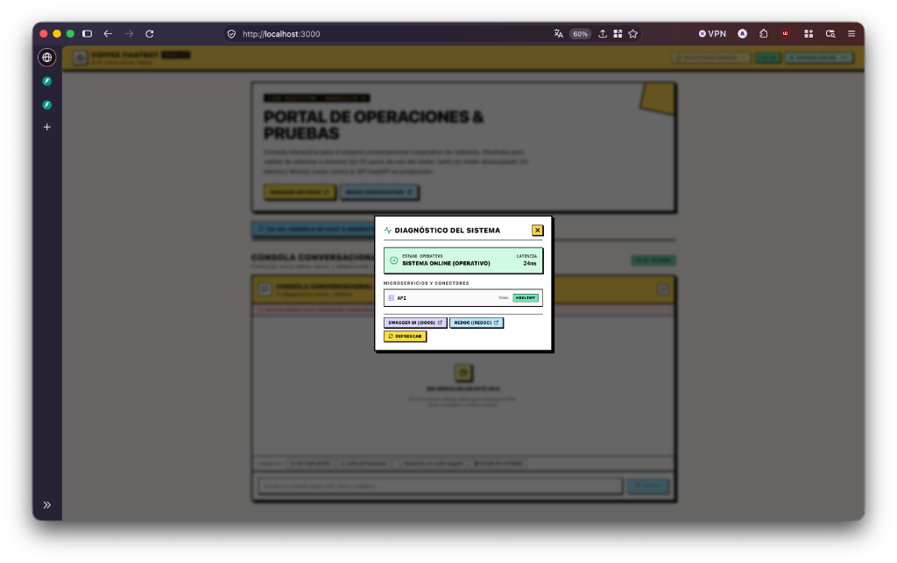
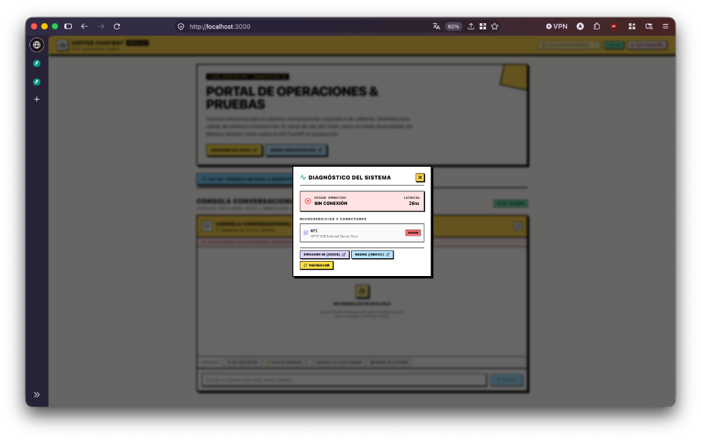

# ☕ AI Conversation Platform — Operations & Testing Portal
### `apps/chatbot/web/portal`

[](https://nextjs.org/)
[](https://www.typescriptlang.org/)
[](https://tailwindcss.com/)
[]()
[]()
[-emerald?style=flat&logo=vitest)]()

---

## 🎯 Executive Summary & Purpose

The **AI Conversation Platform Portal** is an enterprise-grade administrative and operations console for the **Coffee Chatbot & Conversational AI Engine**. Built with **Next.js 14 App Router**, **TypeScript**, and **Clean Architecture**, it provides complete operational observability and interactive validation for the platform's hexagonal core.

Designed with **3D Neubrutalism aesthetics**, the interface delivers high visual contrast, tactile mechanical responsiveness, and strict security guarantees for multi-tenant enterprise deployments.

---

## 🏛️ Architectural Foundation (Clean Architecture)

The codebase strictly decouples business domain rules from frameworks and network protocols across 4 discrete layers:

```
src/
├── domain/                      # Pure Business Rules (No React/Next.js dependencies)
│   ├── health/                  # SystemHealth Entity, HealthStatusLevel, HealthGatewayPort
│   ├── tenants/                 # TenantId (VO), Tenant Entity, TenantTier, TenantGatewayPort
│   └── conversations/           # IdempotencyKey (VO), Message Entity, ConversationAggregate
├── application/                 # Use Cases & Reactive Orchestration (TanStack Query)
│   ├── health/                  # useSystemHealth hook (background polling & stale-time policies)
│   ├── tenants/                 # TenantContext, useTenant, useTenantsList
│   └── conversations/           # useConversation, useSendMessage (optimistic updates & deduplication)
├── infrastructure/              # Network Adapters, Storage & Gateway Implementations
│   ├── api/                     # HttpHealthAdapter, HttpTenantAdapter, HttpConversationAdapter,
│   │                            # MockHealthGateway, MockTenantGateway, MockConversationGateway,
│   │                            # apiClient (transparent X-Tenant-Id injector)
│   ├── storage/                 # tenantSessionStore (session-scoped tenant isolation)
│   └── container.ts             # Dependency Injection container toggled via feature flag
└── presentation/                # UI Components & Atomic Design (3D Neubrutalism)
    ├── components/
    │   ├── health/              # SystemStatusPill, SystemStatusModal
    │   ├── tenants/             # TenantSelectorDropdown, TenantAvatar, TenantTierBadge, TenantSwitchGuardModal
    │   └── chat/                # ChatConsole, ChatTimeline, MessageBubble, ChatInput
    ├── layouts/                 # DashboardHeader
    └── providers/               # QueryProvider, TenantProvider
```

---

## 🚀 Key Implemented Modules & Use Cases

### 1. CU-01: System Health & Diagnostic Monitor
- **Continuous Heartbeat:** Real-time polling with millisecond latency measurement.
- **Tolerant Reader Pattern:** Gracefully ingests legacy `{"status": "ok"}` responses as well as detailed RFC-01 microservice payloads (MSSQL database checks, RabbitMQ broker latency).
- **Diagnostics Modal:** 3D elevated diagnostic panel displaying component states, direct documentation links (`/docs` and `/redoc`), and instant refresh trigger.

| Live Healthy State (`SISTEMA ONLINE`) | Service Down / Fallback State (`SIN CONEXIÓN`) |
| :---: | :---: |
|  |  |

---

### 2. CU-02: Multi-Tenant Context & Data Isolation
- **Organization Selector:** Tactical 3D dropdown featuring tenant initial avatars and tier badges (`FREE`, `PRO`, `ENTERPRISE`).
- **Transparent Context Propagation:** Client-side interceptor automatically injects `X-Tenant-Id: <slug>` into all outgoing business requests.
- **Cross-Tenant Data Leakage Guard:** `TenantSwitchGuardModal` intercepts workspace changes when active conversational state exists, requiring explicit confirmation to flush volatile memory.

---

### 3. CU-03: Conversational Console & Distributed Idempotency
- **Cryptographic Idempotency Keys:** Every send action generates a unique `UUIDv4` transmitted via the `Idempotency-Key` HTTP header.
- **Turn Alternation Invariant:** Strictly prevents appending multiple user messages before the assistant responds (`Cannot append user message before assistant responds`).
- **Optimistic UI with Rollback:** User messages appear immediately in the timeline with a visual "in-flight" status; changes roll back cleanly if a network error occurs.
- **Anti-Double-Submit Protection:** Input fields and mechanical 3D submit buttons lock automatically while mutations are processing.

---

## 📊 Master Traceability Matrix

| ID | Specification Document | Use Case Name | Backend Step | Slice | Status |
| :--- | :--- | :--- | :--- | :--- | :---: |
| **01** | [`01-cu-01-system-health.md`](docs/roadmap/01-cu-01-system-health.md) | **System Health & Availability Monitor** | Step 1: Health & Docs | Hexagonal Base | 🟢 **Validated** |
| **02** | [`02-cu-02-tenant-isolation.md`](docs/roadmap/02-cu-02-tenant-isolation.md) | **Tenant Selector & Workspace Isolation** | Step 2: Multi-Tenancy | Slice 6 | 🟢 **Validated** |
| **03** | [`03-cu-03-chat-idempotency.md`](docs/roadmap/03-cu-03-chat-idempotency.md) | **Conversational Console & Idempotency** | Step 3: Idempotency | Slices 1, 2, 5 | 🟢 **Validated** |
| **04** | [`04-cu-04-outbox-worker-monitor.md`](docs/roadmap/04-cu-04-outbox-worker-monitor.md) | **Outbox Worker & Asynchronous Dispatch** | Step 6: Decoupled Worker | Slice 4 | 🟡 In Roadmap |
| **05** | [`05-cu-05-governance-budget.md`](docs/roadmap/05-cu-05-governance-budget.md) | **Tenant Quotas & Cost Governance** | Step 5: Tenant Governance | Slice 6 | 🟡 In Roadmap |
| **06** | [`06-cu-06-hitl-approvals.md`](docs/roadmap/06-cu-06-hitl-approvals.md) | **Human-in-the-Loop Approvals Center** | Step 8: Tool Calling & HITL | Slice 8 | 🟡 In Roadmap |
| **07** | [`07-cu-07-hybrid-rag-knowledge.md`](docs/roadmap/07-cu-07-hybrid-rag-knowledge.md) | **Document Ingestion & Hybrid RAG** | Step 7: Knowledge & RAG | Slice 7 | 🟡 In Roadmap |
| **08** | [`08-cu-08-resilient-sse-streaming.md`](docs/roadmap/08-cu-08-resilient-sse-streaming.md) | **Resilient Real-Time Streaming (SSE)** | Step 4: SSE & Recovery | Slices 2, 5 | 🟡 In Roadmap |
| **09** | [`09-cu-09-multi-agent-workflows.md`](docs/roadmap/09-cu-09-multi-agent-workflows.md) | **Multi-Agent Workflow State Graph** | Step 9: State Graphs | Slice 9 | 🟡 In Roadmap |
| **10** | [`10-cu-10-ai-guardrails-observability.md`](docs/roadmap/10-cu-10-ai-guardrails-observability.md) | **AI Security Guardrails & Audit Logs** | Step 10: AI Governance | Slice 10 | 🟡 In Roadmap |

---

## ⚡ Dual Execution Modes

The portal features an in-memory mock engine that allows **100% autonomous development and UI testing** without requiring Docker or a running backend:

| Feature | Mock Mode (`NEXT_PUBLIC_USE_MOCKS=true`) | Live API Mode (`NEXT_PUBLIC_USE_MOCKS=false`) |
| :--- | :--- | :--- |
| **Dependencies** | None (Runs purely in browser memory) | FastAPI backend running on port `8000` |
| **Health Checks** | Simulated rich RFC-01 (DB, Broker latencies) | Calls `/health` via Tolerant Reader & Next.js proxy |
| **Tenants** | In-memory catalog (`Acme Corp`, `Globex`, etc.) | Fetches from `GET /admin/tenants` |
| **Conversations** | In-memory store with simulated bot replies | Dispatches `POST /conversations` with UUID keys |
| **CORS Handling** | Not applicable | Transparent Next.js reverse proxy (`next.config.js`) |

Toggle modes in `.env.local`:
```bash
# In-Memory Mode (Autonomous UI Testing)
NEXT_PUBLIC_USE_MOCKS=true

# Live Backend Mode
NEXT_PUBLIC_USE_MOCKS=false
NEXT_PUBLIC_API_URL=http://localhost:8000
```

---

## 🎨 3D Neubrutalism Design System

The visual design language is built using custom Tailwind CSS utility tokens:
- **Rigid Outlines:** `border-2 border-black` and `border-4 border-black` for high-contrast separation.
- **Hard Drop Shadows:** Zero-blur offsets (`shadow-neo-sm: 2px 2px 0px #000`, `shadow-neo: 4px 4px 0px #000`, `shadow-neo-lg: 6px 6px 0px #000`).
- **Tactile Mechanical Micro-interactions:** Tactile `:active` button displacement (`active:translate-x-0.5 active:translate-y-0.5 active:shadow-none`).
- **Color Palette:** Warm cream canvas (`#FFFDF8`), cyber yellow (`#FBBF24`), electric blue (`#3B82F6`), mint green (`#10B981`), and alert coral (`#EF4444`).

---

## 🧪 Quality Assurance & Test Strategy (TDD)

Every feature is developed following the **Red-Green-Refactor** TDD workflow with unit and component tests written in **Vitest** and **React Testing Library**:

- **78 Automated Tests** across **26 Test Suites** (100% Passing).
- **Domain Tests:** Value object validations, invariants, and aggregate behaviors.
- **Adapter Tests:** Tolerant reader response parsing, error states, and header injections.
- **Component Tests:** Neubrutalism styling, ARIA roles, click handlers, and modal dismissals.

To execute the test suite:
```bash
npm test
```

---

## 🛠️ Getting Started

### Prerequisites
- **Node.js:** `v18.17+` or `v20.x` (Recommended: `v20.19.0`)
- **Package Manager:** `npm` (v10+)

### Installation
```bash
# Clone and navigate to the portal directory
cd apps/chatbot/web/portal

# Install dependencies
npm install
```

### Development Server
```bash
# Start Next.js local server
npm run dev
```
Open **[http://localhost:3000](http://localhost:3000)** in your browser.

### Available Scripts

| Command | Purpose |
| :--- | :--- |
| `npm run dev` | Starts local Next.js development server at `http://localhost:3000` |
| `npm test` | Runs all 78 Vitest test suites once |
| `npm run test:watch` | Runs Vitest in interactive watch mode |
| `npm run build` | Compiles optimized Next.js production build and checks TypeScript types |
| `npm start` | Runs the production build server |

---

## 👥 Engineering & Delivery Standards
- **Branch Strategy:** Feature branches (`feat/01-system-health`, `feat/02-tenant-isolation`, `feat/03-chat-idempotency`) merged into `development`, then promoted to `main`.
- **Commit Convention:** Strict [Conventional Commits](https://www.conventionalcommits.org/) (`feat(...)`, `test(...)`, `docs(...)`, `fix(...)`).
- **Code Standards:** TypeScript strict mode, Clean Architecture layer separation, zero direct coupling between Presentation and Infrastructure.
