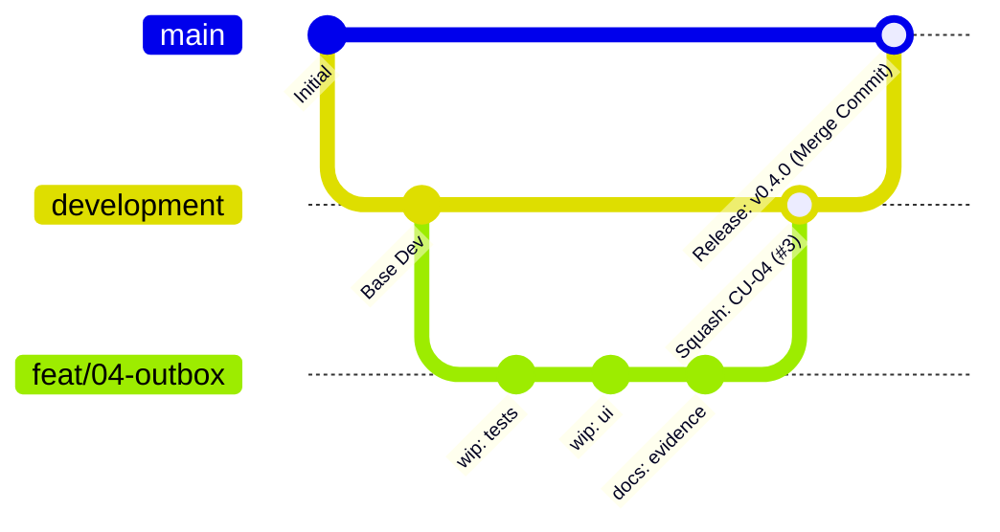

# 🌿 Git Branching Strategy & Delivery Standards

This repository follows a disciplined Git workflow combining **Feature Isolation**, **Atomic Squashing**, and **Linear Main Branch Releases**.

---

## 1. Branch Topology

- **`main`**: Production-ready, stable codebase. Every commit in `main` represents a verified milestone or release.
- **`development`**: Integration branch. Contains all completed, tested, and approved features.
- **`feat/<id>-<slug>`**: Ephemeral feature branches (e.g., `feat/04-outbox-worker-monitor`, `feat/05-governance-budget`).

---

## 2. Standard Promotion Lifecycle



### Phase 1: Feature Development (`feat/*` ➔ `development`)
1. Create a feature branch off latest `development`:
   ```bash
   git checkout development && git pull origin development
   git checkout -b feat/<id>-<slug>
   ```
2. Develop using TDD (Red-Green-Refactor).
3. Validate:
   - `npm test` (100% tests passing).
   - `npm run build` (zero type errors).
   - Capture manual testing screenshots with Puppeteer into `docs/assets/`.
   - Update `README.md` with visual comparison tables and test metrics.
4. Push and open PR towards `development`:
   ```bash
   gh pr create --base development --head feat/<id>-<slug> ...
   ```
5. **Merge Strategy:** **Squash and Merge (`gh pr merge <id> --squash`)**.
   - Collapses noisy intermediate WIP commits into **1 single atomic Conventional Commit**.
   - Format: `feat(<scope>): <description> (#<pr_id>)`.

---

### Phase 2: Promotion to Production (`development` ➔ `main`)
1. Verify `development` contains all intended features and CI is green.
2. Open Pull Request from `development` to `main`:
   ```bash
   gh pr create --base main --head development ...
   ```
3. **Merge Strategy:** **Merge Commit (`gh pr merge <id> --merge`)** or **Fast-Forward**.
   > [!IMPORTANT]
   > **DO NOT Squash Merge from `development` to `main`**:
   > Squash-merging `development` creates a new commit hash on `main` that does not exist on `development`, causing the two branches to diverge immediately and generating false merge conflicts on future PRs.
   > Using **Merge Commit (`--merge`)** preserves the exact commit history of `development`, maintaining synchronization and a clean release audit trail.

---

### Phase 3: Continuous Integration (CI)
GitHub Actions (`.github/workflows/ci.yml`) runs automatically on all PRs and pushes to `development` and `main`:
1. `npm ci`
2. `npm run build`
3. `npm test`
