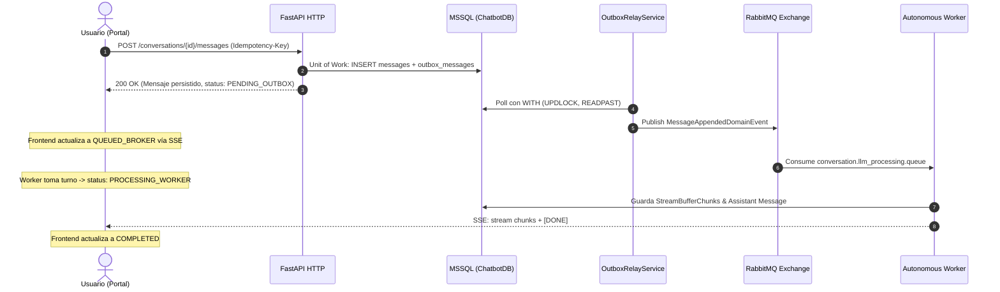

# 📐 CU-04: Monitor de Despacho Asíncrono y Outbox (Worker & Broker Lifecycle)
## Hoja de Ruta Frontend (`apps/chatbot/web/portal/docs/roadmap/04-cu-04-outbox-worker-monitor.md`)

| Atributo | Detalle |
| :--- | :--- |
| **Identificador** | **CU-04** |
| **Paso del Backend Walkthrough** | **Step 6: Decoupled Worker, RabbitMQ & Transactional Outbox** ([`AI_CONVERSATION_PLATFORM_API.README.md`](file:///Users/angel.szymczak/Vaults/Harvis/300-MEMORIA_DIGITAL/475-Sites/AngelSolutions/Company/platform/convo/chatbot-ai-rag-langchain/apps/chatbot/web/portal/docs/AI_CONVERSATION_PLATFORM_API.README.md#L499)) |
| **Slice Backend Vinculado** | Slice 4 (Decoupled Event Broker Worker & Outbox Pattern) |
| **Componentes de Infraestructura Backend** | SQL Server 2022 (`outbox_messages`), RabbitMQ Topic Exchange (`conversation.events`), Autonomous Worker (`src/worker.py`), DLQ (`conversation.dlx`) |
| **Estado de Implementación** | 🟡 Especificado (Listo para TDD) |

---

## 🎯 1. Objetivos de Negocio y Experiencia de Usuario (UX)

### 1.1 El Problema
En arquitecturas distribuidas orientadas a eventos, la inserción del mensaje de usuario es síncrona e instantánea (<50ms vía Transactional Outbox en MSSQL), pero el procesamiento del LLM, el enrutamiento dinámico y la generación de la respuesta se delegan de forma asíncrona a RabbitMQ y a un worker autónomo en segundo plano.

Si la interfaz web trata el envío como un proceso opaco:
1. El usuario no sabe si su mensaje fue recibido por la base de datos, si está encolado esperando recursos o si el worker de IA ya comenzó la inferencia.
2. Si ocurre un fallo crítico y el mensaje se desvía a la cola de mensajes no entregados (**Dead Letter Queue / DLQ**), la interfaz quedaría congelada en un spinner infinito sin feedback para el usuario.

### 1.2 La Solución Neubrutalism 3D
1. **`MessageDeliveryStatusBadge` (Micro-Badge Táctil):**
   - Un badge reactivo adosado al pie de cada burbuja de mensaje de usuario en la línea de tiempo.
   - Borde negro sólido de `2px`, sombra plana de `2px 2px 0px #000`, e iconos retro con transiciones de estado explícitas:
     - ⚪ **`PENDING_OUTBOX`:** Fondo gris pizarra cálido (`#F1F5F9`), texto "En cola (Outbox)", icono de reloj de arena.
     - 🟡 **`QUEUED_BROKER`:** Fondo amarillo cyber (`#FEF3C7`), borde negro, texto "Encolado (RabbitMQ)", micro-pulso ámbar.
     - 🔵 **`PROCESSING_WORKER`:** Fondo azul suave (`#DBEAFE`), borde negro, texto "Worker procesando...", micro-icono de engranaje animado.
     - 🟢 **`COMPLETED`:** Fondo verde menta (`#D1FAE5`), borde negro, texto "Entregado", checkmark sólido.
     - 🔴 **`FAILED_DLQ`:** Fondo rojo alerta (`#FEE2E2`), borde negro `2px`, texto "Error en procesamiento (DLQ)", botón táctil "Reintentar".
2. **Transición Fluida hacia el Streaming (CU-08):**
   - En cuanto el worker inicia la inferencia LLM y emite el primer evento, el badge transiciona automáticamente a estado `PROCESSING_WORKER` y se monta el cursor de tipeo del asistente.

---

## 🔌 2. Contrato de Integración y Ciclo de Vida de Eventos

### 2.1 Ciclo de Vida del Despacho Asíncrono



### 2.2 Eventos SSE de Ciclo de Vida
Al conectarse a `GET /conversations/{conversation_id}/stream`:
- `event: message_status`  
  `data: {"message_id": "msg-123", "status": "QUEUED_BROKER"}`
- `event: worker_started`  
  `data: {"message_id": "msg-123", "worker_id": "worker-node-1", "model": "gpt-4o"}`
- `event: completed`  
  `data: {"message_id": "msg-123", "status": "COMPLETED", "tokens_processed": 142}`
- `event: error_dlq` *(En caso de fallo irrecuperable en worker)*  
  `data: {"message_id": "msg-123", "status": "FAILED_DLQ", "reason": "Model Provider Timeout"}`

---

## 🏛️ 3. Arquitectura Frontend (Clean Architecture)

```
src/
├── domain/messaging/
│   ├── DeliveryStatus.ts            # Value Object: Enum de estados de entrega
│   └── MessageDeliveryState.ts      # Entidad: messageId, status, retryCount, error
├── application/messaging/
│   ├── useMessageDeliveryStatus.ts  # Hook orquestador de estados del mensaje
│   └── messageDeliveryReducer.ts    # Máquina de estados finita (FSM)
├── infrastructure/sse/
│   └── sseLifecycleAdapter.ts       # Parser de eventos de ciclo de vida del worker
└── presentation/components/chat/
    ├── MessageDeliveryStatusBadge.tsx # Badge Neubrutalism 3D reactivo
    └── MessageDeliveryTooltip.tsx    # Tooltip de diagnóstico técnico
```

### 3.1 Value Object: `DeliveryStatus` (`domain/messaging/DeliveryStatus.ts`)
```typescript
export type DeliveryStatus =
  | 'PENDING_OUTBOX'
  | 'QUEUED_BROKER'
  | 'PROCESSING_WORKER'
  | 'COMPLETED'
  | 'FAILED_DLQ';

export class MessageDeliveryState {
  constructor(
    public readonly messageId: string,
    public readonly status: DeliveryStatus,
    public readonly updatedAt: Date,
    public readonly workerId?: string,
    public readonly errorMessage?: string
  ) {}

  get isTerminal(): boolean {
    return this.status === 'COMPLETED' || this.status === 'FAILED_DLQ';
  }

  get requiresAttention(): boolean {
    return this.status === 'FAILED_DLQ';
  }
}
```

### 3.2 Componente Neubrutalism 3D: `MessageDeliveryStatusBadge.tsx`
```typescript
import React from 'react';
import { DeliveryStatus } from '@/domain/messaging/DeliveryStatus';

interface Props {
  status: DeliveryStatus;
  onRetry?: () => void;
}

export const MessageDeliveryStatusBadge: React.FC<Props> = ({ status, onRetry }) => {
  const config = {
    PENDING_OUTBOX: {
      text: 'En cola (Outbox)',
      bg: 'bg-slate-100 dark:bg-slate-800 text-slate-800 dark:text-slate-200',
      icon: '⏳',
    },
    QUEUED_BROKER: {
      text: 'Encolado (RabbitMQ)',
      bg: 'bg-amber-100 text-amber-900 border-amber-400',
      icon: '⚡',
    },
    PROCESSING_WORKER: {
      text: 'Generando respuesta...',
      bg: 'bg-blue-100 text-blue-900 border-blue-400',
      icon: '⚙️',
    },
    COMPLETED: {
      text: 'Entregado',
      bg: 'bg-emerald-100 text-emerald-900 border-emerald-400',
      icon: '✓',
    },
    FAILED_DLQ: {
      text: 'Error en Worker (DLQ)',
      bg: 'bg-red-100 text-red-900 border-red-500',
      icon: '✕',
    },
  }[status];

  return (
    <div
      role="status"
      className={`inline-flex items-center gap-1.5 px-2 py-0.5 text-xs font-bold border-2 border-black dark:border-white shadow-[2px_2px_0px_#000] rounded-sm transition-all ${config.bg}`}
    >
      <span>{config.icon}</span>
      <span>{config.text}</span>
      {status === 'FAILED_DLQ' && onRetry && (
        <button
          onClick={onRetry}
          className="ml-1 underline font-extrabold hover:text-red-700 active:translate-y-0.5"
        >
          Reintentar
        </button>
      )}
    </div>
  );
};
```

---

## 🧪 4. Especificación BDD en Gherkin (`.feature`)

Archivo: `tests/e2e/features/cu-04-outbox-worker-monitor.feature`

```gherkin
Feature: CU-04 - Feedback de Procesamiento Asíncrono y Outbox
  Como usuario del portal conversacional
  Quiero visualizar el ciclo de vida del despacho asíncrono de mi mensaje
  Para tener certeza de cuándo fue encolado, cuándo lo procesa el worker y detectar fallos tempranos

  Background:
    Given que el tenant "corp-acme" está activo
    And el usuario envía el mensaje "Procesar auditoría de sistemas"

  Scenario: Transición normal de estados del mensaje (Happy Path)
    Then el mensaje muestra inicialmente el badge "En cola (Outbox)" con fondo pizarra
    When el servicio OutboxRelay publica el evento a RabbitMQ
    Then el badge transiciona dinámicamente a "Encolado (RabbitMQ)" con micro-pulso ámbar
    When el worker autónomo inicia la ejecución de inferencia
    Then el estado cambia a "Generando respuesta..." con fondo azul y spinner mecánico
    When la respuesta del asistente concluye exitosamente
    Then el badge se actualiza a "Entregado" con fondo verde esmeralda y borde sólido

  Scenario: Detección y manejo visual de fallo en Dead Letter Queue (DLQ)
    Given que el worker autónomo experimenta un fallo no recuperable de proveedor
    When el mensaje es desviado a "conversation.dlx" (Dead Letter Queue)
    Then el badge del mensaje cambia a fondo rojo alerta con texto "Error en Worker (DLQ)"
    And se habilita un botón táctil "Reintentar"
    And se presenta una sugerencia de contingencia sin bloquear la interfaz general
```

---

## 🛠️ 5. Mock Service Worker (MSW) Handlers & Fixtures

```typescript
// src/mocks/handlers/outboxHandlers.ts
import { http, HttpResponse, delay } from 'msw';

export const outboxHandlers = [
  // Endpoint simulado de estado de entrega de mensaje
  http.get('http://localhost:8000/conversations/:id/messages/:msgId/status', async ({ params }) => {
    await delay(50);
    return HttpResponse.json({
      message_id: params.msgId,
      status: 'PROCESSING_WORKER',
      queue: 'conversation.llm_processing.queue',
      broker: 'rabbitmq',
      worker_id: 'worker-node-alpha',
      dispatched_at: new Date().toISOString(),
    });
  }),
];
```

---

## 🔬 6. Estrategia TDD (Vitest & React Testing Library)

1. **`MessageDeliveryState.test.ts` (Unit Test):**
   - Verifica transiciones válidas de la máquina de estados (`PENDING_OUTBOX` ➔ `QUEUED_BROKER` ➔ `PROCESSING_WORKER` ➔ `COMPLETED`).
   - Verifica el flag `isTerminal` para estados finales y `requiresAttention` para `FAILED_DLQ`.
2. **`useMessageDeliveryStatus.test.ts` (Hook Test con MSW):**
   - Evalúa el cambio reactivo de estado cuando se emiten eventos de ciclo de vida.
   - Comprueba la invocación de callbacks al llegar a estados terminales.
3. **`MessageDeliveryStatusBadge.test.tsx` (Component Test):**
   - Verifica que cada estado renderice su texto, color y borde característico de Neubrutalism (`border-2 border-black`, `shadow-[2px_2px_0px_#000]`).
   - Comprueba que en estado `FAILED_DLQ` se renderice el botón de reintento y se dispare el evento `onRetry`.

---

## 🚀 7. Propuestas de Mejora para el Backend (Feedback / RFC)

Durante el análisis del desacoplamiento asíncrono entre la API y el Worker, se formulan los siguientes RFCs de mejora para el backend:

### RFC-10: Endpoint Ligero de Consulta de Estado del Outbox (`GET /messages/{id}/delivery-status`)
- **Situación Actual:** `POST /conversations/{id}/messages` retorna de inmediato, pero no existe un endpoint REST dedicado para consultar el estado del mensaje en el Outbox o cola (`GET /messages/{id}/delivery-status`). Actualmente el frontend debe conectarse obligatoriamente al stream SSE para deducir si el worker comenzó a responder.
- **Propuesta:** Crear un endpoint OData/REST ligero:
  ```http
  GET /conversations/{conversation_id}/messages/{message_id}/delivery-status
  ```
  Que devuelva el estado actual desde la tabla `outbox_messages` (`PENDING`, `DISPATCHED`, `FAILED`).
- **Beneficio Frontend:** Permite verificar el estado en reconexiones sin sobrecargar el bus de SSE.

### RFC-11: Eventos de Ciclo de Vida Estandarizados en el Canal SSE
- **Situación Actual:** El endpoint SSE `GET /conversations/{id}/stream` emite únicamente chunks de texto (`data: token\n\n`) y al final `[DONE]`. No emite eventos tipados de ciclo de vida de la infraestructura.
- **Propuesta:** Enriquecer el stream con eventos SSE formales con nombres de evento estándar:
  ```http
  event: worker_lifecycle
  data: {"stage": "DEQUEUED", "worker": "worker-1", "model": "gpt-4o", "latency_queue_ms": 14}
  ```
- **Beneficio:** Habilita al portal mostrar métricas de telemetría en tiempo real sobre la latencia de RabbitMQ y el worker.

### RFC-12: Evento Explícito de Envío a Dead Letter Queue (DLQ Notification)
- **Situación Actual:** Si el worker falla tras agotar sus reintentos y descarta el mensaje a `conversation.llm_processing.dlq`, el cliente web no recibe una notificación en el stream y puede quedarse esperando un timeout.
- **Propuesta:** Publicar un evento de error estructurado en el stream del usuario antes de cerrar la conexión o marcar el mensaje en base de datos con `status: DLQ_REJECTED`.

---

## ✅ 8. Criterios de Aceptación (Definition of Done - DoD)

- [ ] Value Object `DeliveryStatus` y entidad `MessageDeliveryState` creados en `domain/messaging/` con pruebas unitarias.
- [ ] Hook `useMessageDeliveryStatus` implementado en `application/messaging/`.
- [ ] Componente `MessageDeliveryStatusBadge` maquetado con Neubrutalism 3D, soporte para los 5 estados e interacción de reintento.
- [ ] Integración del badge en la burbuja de mensaje de usuario dentro de `ChatTimeline`.
- [ ] Handlers MSW configurados para simular transiciones de estado de Outbox y DLQ.
- [ ] Escenarios Gherkin de CU-04 listos para validación con Playwright-BDD.
