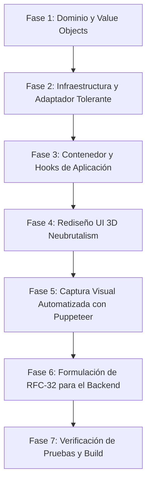

# Plan de Auditoría, Refactorización e Integración en Vivo — CU-02: Aislamiento y Contexto Multi-Tenant

> **Rama de Trabajo:** `refactor/02-multi-tenant-isolation`  
> **Estado:** Propuesto para Aprobación  
> **Objetivo:** Refactorizar integralmente el Caso de Uso 02 bajo Clean Architecture y 3D Neubrutalism, conectar en vivo con `http://localhost:8000/admin/tenants`, asegurar compatibilidad total de contratos, generar capturas con Puppeteer y redactar la especificación técnica **RFC-32**.

---

## 1. Diagnóstico Actual y Hallazgos de la Auditoría

### 1.1 Verificación del Backend en Vivo (`http://localhost:8000/admin/tenants`)
Al consultar el endpoint en el backend real:
```json
[
  {
    "tenant_id": "corp-acme",
    "name": "ACME Corporation",
    "status": "ACTIVE",
    "tier": "STANDARD",
    "balance": "1000.0000",
    "reserved_amount": "0.0000",
    "available_balance": "1000.0000",
    "currency": "USD"
  },
  {
    "tenant_id": "default-tenant",
    "name": "Default System Tenant",
    "status": "ACTIVE",
    "tier": "STANDARD",
    "balance": "1000.0000",
    "reserved_amount": "0.0000",
    "available_balance": "1000.0000",
    "currency": "USD"
  }
]
```

### 1.2 Discrepancias Detectadas
1. **Identificador del Tenant:** El `GET /admin/tenants` retorna `tenant_id`, mientras que `CreateTenantRequest` en OpenAPI espera `id`. El frontend debe aplicar el patrón **Tolerant Reader** para resolver `raw.id || raw.tenant_id`.
2. **Nivel de Contrato (`TenantTier`):** El backend expone `tier: "STANDARD"` además de `ENTERPRISE` y `FREE`. El modelo de dominio de frontend solo contemplaba `FREE | PRO | ENTERPRISE`.
3. **Metadatos Financieros en Tiempo Real:** El backend provee `balance`, `available_balance`, `currency` y `status`. El modelo de dominio `Tenant` actual no los aprovechaba para la vista de usuario.
4. **Desconexión con el Selector de Entorno:** `container.tenantGateway` estaba fijado a una variable de entorno estática en lugar de suscribirse a `runtimeEnvironmentStore.getMode()` como hicimos con CU-01.

---

## 2. Plan de Ejecución por Fases



---

### Fase 1: Dominio (`src/domain/tenants/`)
- [x] **`TenantTier.ts`:**
  - [x] Ampliar tipo: `export type TenantTier = 'FREE' | 'STANDARD' | 'PRO' | 'ENTERPRISE';`
  - [x] Helpers puros: `getTenantTierBadgeStyle(tier: TenantTier)` y `formatTenantTier(tier: TenantTier)`.
- [x] **`Tenant.ts`:**
  - [x] Agregar campos opcionales del contrato real: `status?: string`, `balance?: string`, `currency?: string`, `availableBalance?: string`.
  - [x] Método helper `formattedBalance`: ej. `"$1,000.00 USD"`.
  - [x] Mantener invariantes y métodos existentes (`initials`, `isEnterprise`).
- [x] **`TenantId.ts`:**
  - [x] Mantener validación estricta de slug `^[a-z0-9-]+$`.
- [x] **`TenantGatewayPort.ts`:**
  - [x] Actualizar `CreateTenantInput` para admitir tanto `id` como `name`, `tier`, `balanceUsd`.
- [x] **Tests de Dominio:** Actualizar `Tenant.test.ts` y `TenantId.test.ts` con cobertura del 100%.

---

### Fase 2: Infraestructura (`src/infrastructure/api/`)
- [x] **`HttpTenantAdapter.ts`:**
  - [x] Implementar **Tolerant Reader**:
    - [x] Mapeo bidireccional de `tenant_id` e `id`.
    - [x] Mapeo de `tier` soportando `STANDARD`, `ENTERPRISE`, `PRO`, `FREE`.
    - [x] Captura de balance y moneda.
    - [x] Soporte de timeouts con `AbortController` (3.5s).
    - [x] En `createTenant`, enviar payload compatible: `{ id: input.id, tenant_id: input.id, name: input.name, tier: input.tier, balance_usd: input.initialBudgetUsd }`.
- [x] **`MockTenantGateway.ts`:**
  - [x] Actualizar datos mock para reflejar organizaciones con balances y tiers variados (`ENTERPRISE`, `STANDARD`, `PRO`, `FREE`).
- [x] **`container.ts`:**
  - [x] Configurar `container.tenantGateway` para resolver dinámicamente según `runtimeEnvironmentStore.getMode()`:
    ```typescript
    tenantGateway: {
      getTenants: () => runtimeEnvironmentStore.getMode() === 'LIVE' ? liveTenantAdapter.getTenants() : mockTenantGateway.getTenants(),
      createTenant: (input) => runtimeEnvironmentStore.getMode() === 'LIVE' ? liveTenantAdapter.createTenant(input) : mockTenantGateway.createTenant(input),
    }
    ```
- [x] **Tests de Infraestructura:** Actualizar `HttpTenantAdapter.test.ts` y `MockTenantGateway.test.ts`.

---

### Fase 3: Capa de Aplicación (`src/application/tenants/`)
- [x] **`useTenantsList.ts`:**
  - [x] Conectar con `useRuntimeEnvironment()` para incluir `mode` en la `queryKey: ['tenants-list', mode]`, garantizando refresco inmediato al conmutar entre LIVE y MOCK.
- [x] **`TenantContext.tsx`:**
  - [x] Mantener aislamiento estricto de sesión.
  - [x] Sincronización automática de selección con `tenantSessionStore`.
  - [x] Limpieza controlada de cachés y reset de estado en `confirmSwitchTenant` para garantizar **cero fuga de datos entre inquilinos**.
- [x] **Tests de Aplicación:** Actualizar `TenantContext.test.tsx`.

---

### Fase 4: Rediseño de Presentación 3D Neubrutalism (`src/presentation/components/tenants/`)
- [x] **`TenantSelectorDropdown.tsx`:**
  - [x] Estilo háptico con bordes negros rígidos de `2px`, sombra plana de `3px 3px 0px #000`.
  - [x] Avatar corporativo con iniciales en bloque de color retro.
  - [x] Menú desplegable con elevación 3D (`shadow-[6px_6px_0px_#000]`), listado de organizaciones con selector marcado, badge de tier y balance en tiempo real.
  - [x] Soporte de estado de carga y accesibilidad ARIA completa (`listbox`, `option`).
- [x] **`TenantTierBadge.tsx`:**
  - [x] Paleta Neubrutalista distintiva por nivel:
    - [x] `ENTERPRISE`: Cyber Gold (`bg-amber-300 text-amber-950 border border-black`).
    - [x] `STANDARD` / `PRO`: Electric Cyan / Sky (`bg-sky-300 text-sky-950 border border-black`).
    - [x] `FREE`: Slate Grey (`bg-zinc-200 text-zinc-800 border border-black`).
- [x] **`TenantSwitchGuardModal.tsx`:**
  - [x] Modal Neubrutalista de alerta máxima ante riesgo de contaminación cruzada.
  - [x] Visualización comparativa clara: *Organización Actual* ➔ *Organización Destino*.
  - [x] Indicador de reseteo de sesión y conversación activa.
  - [x] Botones hápticos de confirmación ("Confirmar Cambio") y cancelación con efectos press 3D.
- [x] **Tests de Presentación:** Actualizar `TenantSelectorDropdown.test.tsx`, `TenantSwitchGuardModal.test.tsx`, `TenantTierBadge.test.tsx`.

---

### Fase 5: Capturas de Evidencia con Puppeteer (`scripts/capture-cu02.mjs`)
- [x] Generar script de automatización con Puppeteer para capturar evidencias de alta resolución conectadas en vivo:
  - [x] `cu02_tenant_selector_closed_live.png`: Barra superior mostrando la organización activa en vivo.
  - [x] `cu02_tenant_selector_dropdown_open_live.png`: Menú desplegable abierto con las organizaciones del backend local y sus balances.
  - [x] `cu02_tenant_switch_guard_modal_live.png`: Modal de guardia de aislamiento desplegado ante intento de cambio de tenant con sesión en curso.

---

### Fase 6: Formulación de RFC-32 para el Equipo Backend
- [x] Crear `docs/rfcs/RFC-32-backend-tenant-administration-contract.md`:
  - [x] Documentar la discrepancia `tenant_id` vs `id`.
  - [x] Formalizar el esquema de `TenantSummaryResponse` y `CreateTenantRequest`.
  - [x] Proponer inclusión de campos de auditoría (`created_at`, `updated_at`, `plan_limits`) y avatars corporativos.

---

### Fase 7: Validación de Calidad
- [x] Ejecutar la suite completa de tests (`npm test`): mantener 100% de tests aprobados (93+ archivos).
- [x] Ejecutar `npm run build` sin errores de compilación ni advertencias de tipos.

---

## 3. Criterios de Aceptación
1. [x] El selector de tenants carga y conmuta entre las organizaciones reales del backend (`corp-acme`, `default-tenant`).
2. [x] Se muestra el tier y balance en vivo en el dropdown.
3. [x] El modal `TenantSwitchGuardModal` intercepta cualquier cambio si hay una conversación activa, evitando contaminación de memoria.
4. [x] La conmutación entre modo LIVE y MOCK actualiza el listado de tenants reactivamente.
5. [x] Se capturan y documentan las capturas de pantalla de CU-02.
6. [x] Se publica el documento RFC-32.
7. [x] Todos los tests unitarios y de integración pasan al 100%.
