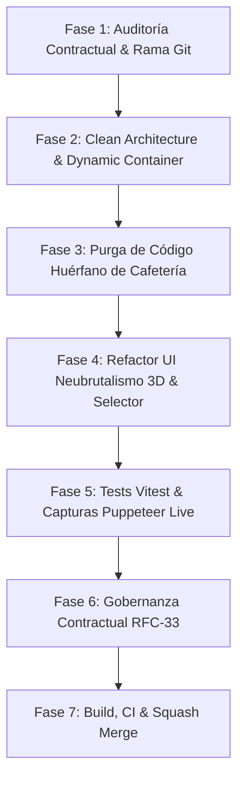

# 📐 Plan de Implementación y Auditoría: CU-03 - Consola Conversacional con Idempotencia Resiliente

> **Caso de Uso:** `CU-03`  
> **Nombre Funcional:** Consola Conversacional con Idempotencia Resiliente  
> **Rama Git:** `feat/03-chat-idempotency` (desde `development`)  
> **RFC Objetivo:** `RFC-33` (`docs/rfcs/RFC-33-backend-chat-idempotency-contract.md`)  
> **Estándares Aplicables:** `.agents/rules/use-case-audit-standards.md` y `.agents/rules/git-workflow.md`

---

## 🎯 1. Resumen de Decisiones de Diseño (/grill-me)

1. **Gestión de Ciclo de Vida y Creación:** Añadir acción "Nueva Conversación" en el encabezado de `ChatConsole`, permitiendo titular y crear conversaciones explícitamente vía `POST /conversations` con `Idempotency-Key` y contexto multi-tenant.
2. **Contrato de Lectura de Historial:** Establecer contrato formal en `RFC-33` requiriendo `GET /conversations/{id}` con Tolerant Reader para mapear agregados y mensajes.
3. **Manejo de Idempotencia y Bloqueo de Turnos:**
   - Generación de `UUIDv4` cliente en cada intención de envío.
   - En caso de fallo transitorio de red, el botón de reintento reutiliza la **misma** `Idempotency-Key`.
   - Protección de invariante de turno (`Cannot append user message before assistant responds` / HTTP 400): el input y botones se deshabilitan con banner visual reactivo hasta que el asistente responde.
4. **Purga de Dominio Huérfano:** Eliminar todo texto y mock residual de "café y pastelería", sustituyéndolo por prompts y entidades Enterprise Cloud del Walkthrough.
5. **Inyección Dinámica de Dependencias:** Estandarizar `container.conversationGateway` con `runtimeEnvironmentStore.getMode()` para alternar `LIVE` (`HttpConversationAdapter`) y `MOCK` (`MockConversationGateway`) sin recompilar.

---

## 📋 2. Fases de Ejecución

### 🔹 Fase 1: Creación de Rama & Auditoría Contractual
- [x] Crear rama `feat/03-chat-idempotency` desde `development`.
- [x] Auditar esquemas OpenAPI del backend para `POST /conversations` y `POST /conversations/{id}/messages`.
- [x] Verificar comportamiento de reintentos idempotentes y respuestas `HTTP 200`, `201`, `400` y `409`.

### 🔹 Fase 2: Clean Architecture & Contenedor Dinámico
- [x] Actualizar `src/infrastructure/container.ts` para resolver dinámicamente `conversationGateway` usando `runtimeEnvironmentStore.getMode()`.
- [x] Fortalecer `HttpConversationAdapter.ts` con manejo robusto de `apiFetch`, cabeceras obligatorias (`X-Tenant-ID`, `Idempotency-Key`) y Tolerant Reader para payloads del backend.
- [x] Separar comandos de mutación (`SendMessageCommand`, `CreateConversationCommand`) de consultas de lectura (`GetConversationQuery`) en `src/application/conversations/`.

### 🔹 Fase 3: Purga de Código Huérfano y Antipatrones
- [x] Reemplazar todos los `QUICK_PROMPTS` de cafetería en `ChatConsole.tsx` por prompts empresariales del Walkthrough:
  - `📊 Calcular presupuesto cloud`
  - `🔒 Consultar política de seguridad`
  - `📑 Resumen de arquitectura multi-tenant`
  - `⚡ Ver cuota de tokens disponible`
- [x] Actualizar `MockConversationGateway.ts` con semillas de datos empresariales (`Enterprise Cloud Migration`, `corp-acme`) y respuestas simuladas consistentes.
- [x] Eliminar tipos y constantes no referenciadas.

### 🔹 Fase 4: Refactor UI Neubrutalismo 3D & Nueva Conversación
- [x] Actualizar `ChatConsole.tsx`:
  - Botón táctil 3D **"Nueva Conversación"** con modal o input inline para título.
  - Indicador neubrutalista de Idempotencia activa con badge de clave UUIDv4.
  - Banner de bloqueo de turno: `"Esperando respuesta del Asistente (Turno Protegido)..."` con animación mecánica.
- [x] Refactorizar `ChatInput.tsx`:
  - Micro-interacción `:active` mecánica (`translate-x-1 translate-y-1 shadow-[1px_1px_0px_#000]`).
  - Estado de reintento idempotente con botón secundario cuando una transmisión falla.
- [x] Mejorar `ChatTimeline.tsx` y `MessageBubble.tsx`:
  - Estados claros para mensajes: `optimistic` (enviando con borde punteado), `confirmed` (persistido) y `error`.

### 🔹 Fase 5: Suite de Pruebas Automatizadas & Capturas Puppeteer
- [x] Actualizar y expandir tests unitarios en Vitest:
  - `HttpConversationAdapter.test.ts` (idempotency, headers, tolerant reader).
  - `useSendMessage.test.tsx` (optimistic updates, turn locking, rollback on error).
  - `ChatConsole.test.tsx` y `ChatInput.test.tsx` (interacciones, estados de bloqueo, botón nueva conversación).
  - `CreateConversationModal.test.tsx` (validación de formulario, interacción de creación y cierre).
  - 100% de la suite pasando: 97 archivos de test, 320 tests unitarios y de integración verdes.
- [x] Crear script de captura Puppeteer `scripts/capture-cu03.mjs`:
  - Captura 1: `cu03_chat_console_overview.png` - Consola conversacional con sugerencias empresariales.
  - Captura 2: `cu03_create_conversation_modal.png` - Modal neubrutalista 3D de creación de conversación.
  - Captura 3: `cu03_turn_protection_guard.png` - Mensaje en vuelo con invariante de turno y banner reactivo.
  - Captura 4: `cu03_conversation_completed.png` - Hilo multi-turno completado con micro-badges de idempotencia UUIDv4.
- [x] Ejecutar capturas y verificar almacenamiento en `docs/assets/`.

### 🔹 Fase 6: Gobernanza Contractual & Documento RFC-33
- [x] Redactar `docs/rfcs/RFC-33-backend-chat-idempotency-contract.md`.
- [x] Especificar los endpoints, headers, payload schemas, comportamiento del middleware de idempotencia y contratos propuestos para lectura de historial (`GET /conversations/{id}`).
- [x] Incrustar diagramas de secuencia e imágenes de evidencia en `docs/assets/`.

### 🔹 Fase 7: Validación de Calidad, Build & Git Delivery
- [x] Ejecutar `make test` (verificar 100% verde: 97 suites, 320 tests pasando).
- [x] Ejecutar `make stack/build` (cero errores TypeScript y Next.js build limpio).
- [x] Commits atómicos en `feat/03-chat-idempotency` bajo Conventional Commits.
- [x] Entrega final y sincronización hacia `development`.

